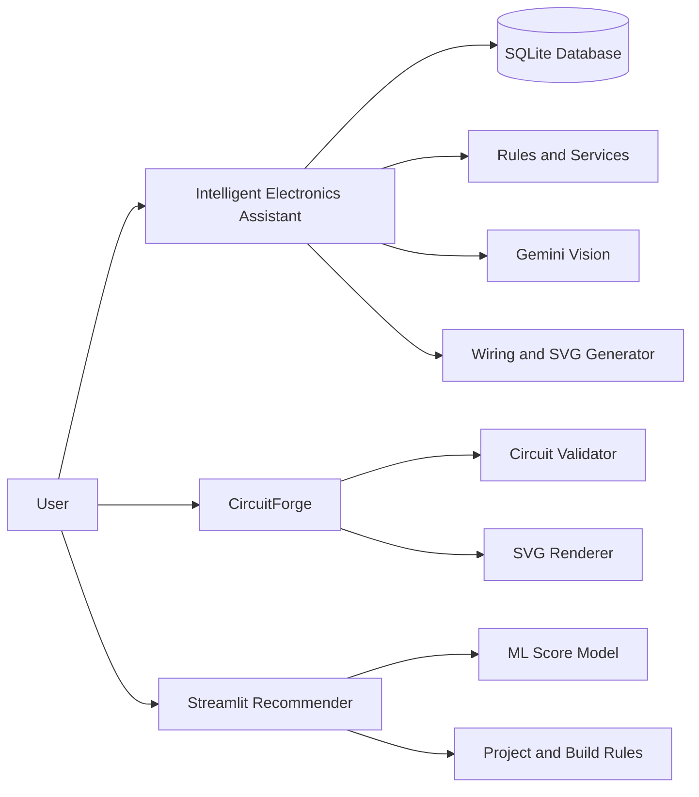

# Sensor Helper Project

Sensor Helper is an educational electronics toolkit for planning, building, and troubleshooting sensor-based circuits. It contains three related applications:

1. **Intelligent Electronics Assistant** - Flask web application.
2. **CircuitForge** - circuit and wiring diagram generator.
3. **IoT Project Recommender** - Streamlit application for project suggestions.

## Features

### Intelligent Electronics Assistant

- Component inventory and alias normalization.
- Project recommendations based on available components.
- Missing-component and alternative suggestions.
- Safety, cost, and feasibility analysis.
- Breadboard and schematic wiring diagrams.
- Beginner-friendly build steps with:
  - Components to connect.
  - Connection locations.
  - Expected output.
  - Safety warnings.
- Build progress tracking.
- Circuit failure diagnosis.
- Local electronics assistant using TF-IDF retrieval.
- Project history and saved projects.
- Gemini-powered component image identification.

### CircuitForge

- Random and custom circuit generation.
- Component dependency resolution.
- Pin allocation and wiring generation.
- Compatibility, voltage, polarity, resistor, power, and ground validation.
- SVG schematic and breadboard diagrams.
- Beginner-oriented build instructions.

### IoT Project Recommender

- Component input and normalization.
- ML-based project score and category.
- Rule-based project generation.
- Feasibility warnings and missing-component suggestions.
- Downloadable JSON results.

## Technology Stack

- **Backend:** Python, Flask, Flask blueprints, Flask-CORS.
- **Database:** SQLite by default, optional MySQL configuration.
- **ORM:** Flask-SQLAlchemy and SQLAlchemy.
- **Frontend:** HTML, CSS, Jinja2, vanilla JavaScript, Fetch API, SVG.
- **Machine learning:** scikit-learn, Logistic Regression, XGBoost, NumPy, pandas.
- **Computer vision:** Pillow and OpenCV.
- **AI integration:** Gemini Vision REST API.
- **Retrieval:** TF-IDF vectorization and cosine similarity.
- **Testing:** pytest and unittest.

## Architecture



## Project Structure

```text
Sensor Helper Project/
├── intelligent-electronics-assistant/   Main Flask application
│   ├── app.py                            Application entry point
│   ├── config.py                         Configuration and environment variables
│   ├── database/                         SQLAlchemy models and seed logic
│   ├── data/                             Components, projects, and rule files
│   ├── ml/                               ML models and scanner logic
│   ├── routes/                           Flask pages and API endpoints
│   ├── services/                         Application business logic
│   ├── templates/                        Web pages
│   ├── static/                           CSS and JavaScript
│   └── tests/                            Automated tests
├── circuit-generator/                    Standalone CircuitForge app
├── engine/                               Streamlit recommendation logic
├── ml/                                   Root ML pipeline and artifacts
├── data/                                 Root application data
├── streamlit_app.py                      Streamlit entry point
├── dataset_generator.py                  Synthetic dataset generator
├── train_model_b.py                      XGBoost training script
└── requirements.txt                      Root dependencies
```

## Machine Learning and AI

### Recommendation models

- The assistant recommendation model uses **Logistic Regression** with standardized feasibility features.
- The root Streamlit pipeline uses an **XGBoost regressor** for project scoring.
- The root dataset is synthetically generated from component combinations and rule-based scores.
- Dataset processing includes cleaning, validation, and class oversampling.

Current dataset files:

| File | Current rows | Purpose |
|---|---:|---|
| `iot_dataset.csv` | 10,000 | Generated raw data |
| `iot_dataset_clean.csv` | 9,988 | Cleaned data |
| `iot_dataset_balanced.csv` | 28,512 | Oversampled balanced data |

### Gemini component scanner

The scanner:

1. Validates the uploaded image.
2. Sends it to Gemini as base64 image data.
3. Requests the most specific electrical/electronic component name.
4. Parses the structured JSON response.
5. Normalizes known aliases.
6. Displays the component or an error when the image is unclear or unidentifiable.

The default model is configured as:

```env
GEMINI_MODEL=gemini-3.1-flash-lite
```

The API key must be stored locally in `.env`:

```env
GEMINI_API_KEY=your_api_key_here
```

Never commit `.env` or expose the API key.

### Local RAG assistant

The local assistant builds a knowledge corpus from component, project, safety, wiring, and diagnosis records. It uses:

1. `TfidfVectorizer`
2. Cosine similarity
3. Top matching database records
4. Deterministic answer generation

An optional OpenAI formulation path exists when `OPENAI_API_KEY` is configured. Gemini is used for image identification, not for the local RAG workflow.

## Setup and Running

### Intelligent Electronics Assistant

The current Windows setup uses the root `venv` environment.

```powershell
cd "C:\Users\anike\OneDrive\Desktop\Sensor Helper Project\intelligent-electronics-assistant"
..\venv\Scripts\python.exe -m pip install -r requirements.txt
Copy-Item .env.example .env
..\venv\Scripts\python.exe -m database.init_db
..\venv\Scripts\python.exe app.py
```

Open: [http://127.0.0.1:5000](http://127.0.0.1:5000)

Scanner page: [http://127.0.0.1:5000/scanner](http://127.0.0.1:5000/scanner)

### CircuitForge

```powershell
cd "C:\Users\anike\OneDrive\Desktop\Sensor Helper Project\circuit-generator"
python -m venv venv
venv\Scripts\python.exe -m pip install -r requirements.txt
venv\Scripts\python.exe app.py
```

Open: [http://127.0.0.1:5001](http://127.0.0.1:5001)

### Streamlit recommender

```powershell
cd "C:\Users\anike\OneDrive\Desktop\Sensor Helper Project"
venv\Scripts\python.exe -m pip install -r requirements.txt
venv\Scripts\python.exe -m streamlit run streamlit_app.py
```

## Testing

### Intelligent Electronics Assistant

```powershell
cd "C:\Users\anike\OneDrive\Desktop\Sensor Helper Project\intelligent-electronics-assistant"
..\venv\Scripts\python.exe -m pytest tests -q
```

Scanner tests only:

```powershell
..\venv\Scripts\python.exe -m pytest tests\test_phase3.py -q -k scanner
```

### CircuitForge

```powershell
cd "C:\Users\anike\OneDrive\Desktop\Sensor Helper Project\circuit-generator"
python -m unittest discover -s tests -t .
```

## Safety Notes

- Disconnect power before changing circuit connections.
- Check component voltage and polarity before powering the circuit.
- Use current-limiting resistors with LEDs.
- Do not connect motors or relays directly to microcontroller GPIO pins.
- Check whether modules require 3.3 V or 5 V.
- Verify AI-identified components with their datasheets.
- AI recognition does not verify component ratings, pinouts, or circuit safety.

## Main API

The Intelligent Electronics Assistant provides APIs for:

- Components: `/api/components`
- Projects: `/api/projects`
- Recommendations: `/api/recommendations`
- Scanner: `POST /api/scanner/predict`
- Wiring: `/api/wiring`
- Diagnosis: `/api/diagnosis`
- Chatbot: `/api/chat`
- History: `/api/history`
- Build progress: `/api/build`

The scanner accepts PNG, JPG, JPEG, and WebP images up to 16 MB using the multipart field `image` or `file`.

## Important Limitations

- Gemini accuracy depends on image quality, model availability, network access, and API limits.
- No verified image-scanner accuracy benchmark is included.
- The root ML dataset is synthetic.
- Generated wiring must be checked against component datasheets.
- SQLite and Flask's development server are intended for local development.
- Optional external AI integrations require their own API keys.

## Documentation

- [Final project documentation](https://drive.google.com/file/d/1IiPKzynea6ZOPXjeWqwQpJk1ytm43pMz/view?usp=sharing)
- [Project development phases documentation](https://docs.google.com/document/d/1rf3xkqB0a2KDRRmQyBRV69WO74wQOaPMdyuBiGtLZHI/edit?usp=sharing)
